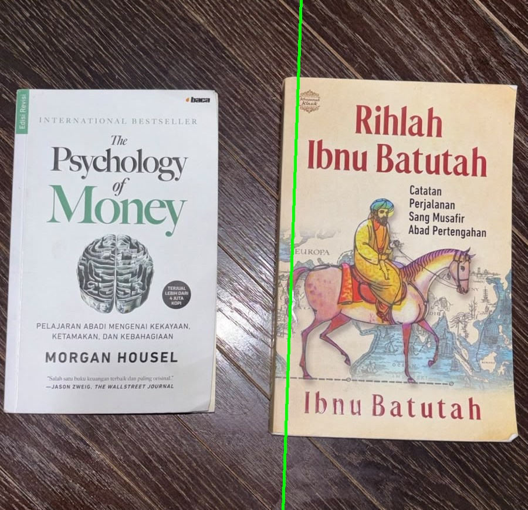

# 📚 Pencarian Sampul Buku di Rak (Book Cover Detection)

## 1. Judul Project

**Pencarian Sampul Buku di Rak Menggunakan Metode ORB dan SIFT**

Project ini merupakan implementasi Computer Vision untuk mendeteksi dan menemukan sampul buku tertentu pada foto yang berisi banyak buku menggunakan teknik Feature Detection dan Feature Matching.

## 2. Nama Anggota Tim dan NPM

**Kelompok 04 – Tema 4**

| No. | Nama Anggota | NPM |
|---|---|---|
| 1 | Muhammad Al-Hadziq Tarmizi | 2108107010022 |
| 2 | M. Anis Fathin | 2408107010045 |
| 3 | Khalish Aufa | 2408107010068 |

## 3. Deskripsi Project

Project ini bertujuan untuk membuat sistem pencarian sampul buku menggunakan teknik pengolahan citra digital dan Computer Vision.

Sistem menerima dua jenis gambar, yaitu:
- **Template:** Foto sampul buku yang ingin dicari.
- **Scene:** Foto rak atau meja yang berisi beberapa buku.

Program akan membandingkan fitur visual dari gambar template dengan gambar scene. Jika buku berhasil ditemukan, sistem akan menandai lokasi buku menggunakan poligon berbentuk empat sisi. Jika tidak ditemukan, sistem akan menampilkan keterangan **"TIDAK DITEMUKAN"**.

Metode yang digunakan adalah:
- ORB (Oriented FAST and Rotated BRIEF).
- SIFT (Scale-Invariant Feature Transform).
- BFMatcher (Brute-Force Matcher).
- Lowe's Ratio Test.
- Homography menggunakan RANSAC.
- Perspective Transform.

## 4. Pipeline Sistem

Pipeline merupakan tahapan proses yang dilakukan sistem mulai dari membaca gambar hingga menghasilkan lokasi buku yang terdeteksi.

### Alur Pipeline

1. **Input Gambar:** Membaca gambar template dan scene menggunakan OpenCV.
2. **Resize:** Menyesuaikan ukuran gambar agar proses lebih efisien dengan tetap mempertahankan rasio aspek.
3. **Grayscale:** Mengubah gambar dari format BGR menjadi grayscale.
4. **Feature Detection:** Mendeteksi keypoint dan descriptor menggunakan ORB atau SIFT.
5. **Feature Matching:** Mencocokkan descriptor template dengan scene menggunakan BFMatcher.
6. **Ratio Test:** Menyaring hasil pencocokan menggunakan Lowe's Ratio Test untuk mengurangi kecocokan yang ambigu.
7. **Homography:** Menghitung transformasi perspektif menggunakan `findHomography()` dengan metode RANSAC.
8. **Perspective Transform:** Mengubah koordinat empat sudut template ke posisi buku pada gambar scene.
9. **Visualisasi:** Menggambar poligon empat sisi pada lokasi buku yang ditemukan atau menampilkan keterangan tidak ditemukan.

### Diagram Pipeline

```text
      INPUT GAMBAR
      /          \
  Template       Scene
      \          /
       RESIZE
          |
       GRAYSCALE
          |
    FEATURE DETECTION
       (ORB / SIFT)
          |
    BF MATCHER
          |
      RATIO TEST
          |
   GOOD MATCHES >= 10?
       /       \
     Ya         Tidak
      |            |
  HOMOGRAPHY    TIDAK
   (RANSAC)    DITEMUKAN
      |
 PERSPECTIVE
   TRANSFORM
      |
 GAMBAR POLIGON
   4 SISI
      |
  HASIL DETEKSI
```

### Contoh Hasil Pipeline



*Gambar menunjukkan proses pencocokan fitur antara template buku dan foto scene serta hasil penandaan lokasi buku.*

## 5. Dataset

Dataset yang digunakan merupakan kumpulan foto sampul buku dan foto adegan rak atau meja yang dibuat untuk pengujian sistem.

Dataset terdiri dari:

### A. Template Buku

Terdapat 5 gambar template sampul buku yang berbeda:

- buku1.jpg
- buku2.jpg
- buku3.jpg
- buku4.jpg
- buku5.jpg

### B. Foto Adegan (Scene)

Terdapat 20 foto adegan yang dibagi menjadi empat kondisi:

| Kondisi | Jumlah | Keterangan |
|---|---:|---|
| Ideal | 8 | Buku terlihat jelas dari depan |
| Sudut Miring | 6 | Buku difoto dari sudut atau perspektif berbeda |
| Tertutup Sebagian | 3 | Sebagian sampul buku terhalang |
| Tanpa Target | 3 | Buku yang dicari tidak terdapat dalam gambar |
| **Total** | **20** | |

### C. Ground Truth

File `ground_truth.csv` digunakan sebagai acuan untuk mengetahui keberadaan buku target pada setiap foto adegan.

Ground truth digunakan untuk mengevaluasi hasil deteksi berdasarkan kategori:
- True Positive (TP)
- False Positive (FP)
- True Negative (TN)
- False Negative (FN)

## 6. Hasil Pengujian

Pengujian dilakukan terhadap 5 template buku dan 20 foto adegan, sehingga menghasilkan total **100 evaluasi pencocokan**.

### Hasil Akurasi ORB

Pengujian menggunakan ORB dengan nilai ratio 0.75 dan minimum 10 good matches.

| Kondisi | TP | FP | TN | FN | Akurasi |
|---|---:|---:|---:|---:|---:|
| Ideal | 19 | 0 | 20 | 1 | 97,5% |
| Sudut Miring | 7 | 0 | 21 | 2 | 93,3% |
| Tertutup | 5 | 1 | 9 | 0 | 93,3% |
| Tanpa Target | 0 | 0 | 15 | 0 | 100% |
| **Keseluruhan** | **31** | **1** | **65** | **3** | **96%** |

### Contoh Hasil Deteksi

Beberapa hasil deteksi dapat dilihat pada folder `Output/`, di antaranya:

- `hasil_ideal_ideal_01.jpg`
- `hasil_sudut_sudut_01.jpg`
- `hasil_tertutup_tertutup_01.jpg`
- `hasil_tanpa_target_tanpa_01.jpg`

Gambar hasil pengujian lainnya tersedia pada folder tersebut.

## 7. Eksperimen Pembanding

Dilakukan dua eksperimen untuk membandingkan performa metode deteksi dan pengaruh nilai ratio test terhadap hasil pencarian buku.

### A. Perbandingan ORB dan SIFT

Eksperimen pertama membandingkan metode ORB dan SIFT menggunakan nilai ratio 0.75.

| Kondisi | ORB | SIFT |
|---|---:|---:|
| Ideal | 97,5% | 92,5% |
| Sudut Miring | 93,3% | 86,7% |
| Tertutup | 93,3% | 80% |
| Tanpa Target | 100% | 100% |
| **Keseluruhan** | **96%** | **90%** |

Perbandingan waktu rata-rata proses deteksi:

| Metode | Waktu Rata-rata |
|---|---:|
| ORB | 0,119 detik |
| SIFT | 0,305 detik |

**Analisis:**

- ORB memiliki akurasi keseluruhan lebih tinggi pada dataset pengujian ini.
- ORB membutuhkan waktu pemrosesan lebih singkat dibandingkan SIFT.
- SIFT menghasilkan rata-rata good matches lebih banyak, tetapi jumlah match yang lebih banyak tidak selalu menghasilkan akurasi lebih tinggi.
- ORB lebih efisien untuk sistem pencarian buku pada pengujian ini.

### B. Pengaruh Nilai Ratio Test

Eksperimen kedua dilakukan dengan membandingkan tiga nilai ratio test, yaitu 0.6, 0.7, dan 0.8 menggunakan ORB.

| Kondisi | Ratio 0.6 | Ratio 0.7 | Ratio 0.8 |
|---|---:|---:|---:|
| Ideal | 97,5% | 97,5% | 95% |
| Sudut Miring | 83,3% | 93,3% | 90% |
| Tertutup | 93,3% | 93,3% | 93,3% |
| Tanpa Target | 100% | 100% | 100% |
| **Keseluruhan** | **93%** | **96%** | **94%** |

**Analisis:**

- Ratio 0.6 memiliki penyaringan yang lebih ketat sehingga jumlah good matches lebih sedikit.
- Ratio 0.7 memberikan keseimbangan yang baik antara jumlah kecocokan fitur dan akurasi.
- Ratio 0.8 menghasilkan lebih banyak good matches, tetapi dapat meningkatkan risiko kecocokan yang salah.

Berdasarkan pengujian, nilai ratio 0.7 memberikan akurasi keseluruhan terbaik sebesar 96% untuk konfigurasi ORB yang diuji.

## 8. Cara Install dan Menjalankan di Laptop Lokal

Berikut langkah-langkah untuk menjalankan project pada laptop lokal.

### A. Persyaratan

Pastikan perangkat sudah memiliki:
- Python 3.10 atau lebih baru.
- pip (Python Package Installer).
- Jupyter Notebook.
- Git (opsional, jika melakukan clone dari GitHub).

### B. Clone Repository

Buka terminal atau VS Code, kemudian jalankan:

```bash
git clone https://github.com/USERNAME/NAMA-REPOSITORY.git
```

Masuk ke folder project:

```bash
cd NAMA-REPOSITORY
```

### C. Install Library

Jalankan perintah berikut untuk memasang library yang dibutuhkan:

```bash
pip install opencv-python numpy matplotlib notebook
```

Library yang digunakan:
- `opencv-python`: Pengolahan citra dan deteksi fitur.
- `numpy`: Operasi array dan perhitungan numerik.
- `matplotlib`: Visualisasi gambar dan grafik.
- `notebook`: Menjalankan Jupyter Notebook.

### D. Menjalankan Project

Jalankan Jupyter Notebook melalui terminal:

```bash
jupyter notebook
```

Kemudian:

1. Buka file `UTS_Kelompok04.ipynb`.
2. Pastikan struktur folder `dataset/` berada pada direktori yang sama dengan notebook.
3. Pastikan folder `Output/` tersedia atau biarkan notebook membuat folder output baru.
4. Jalankan seluruh cell notebook dari awal menggunakan **Run All**.
5. Tunggu hingga seluruh proses evaluasi selesai.
6. Lihat hasil deteksi, grafik perbandingan, dan analisis pengujian pada notebook.

### E. Struktur Folder Project

```text
UTS_VisKom_Kelompok04/
│
├── dataset/
│   ├── template/
│   │   ├── buku1.jpg
│   │   ├── buku2.jpg
│   │   ├── buku3.jpg
│   │   ├── buku4.jpg
│   │   └── buku5.jpg
│   │
│   ├── adegan/
│   │   ├── ideal/
│   │   ├── sudut/
│   │   ├── tertutup/
│   │   └── tanpa_target/
│   │
│   └── ground_truth.csv
│
├── Output/
│   ├── demo_pipeline_buku1.jpg
│   └── hasil deteksi lainnya
│
├── Laporan_Kelompok04.pdf
├── slide_Kelompok04.pdf
├── UTS_Kelompok04.ipynb
└── README.md
```

## 9. Kesimpulan

Berdasarkan hasil implementasi dan pengujian, sistem pencarian sampul buku berhasil dibangun menggunakan metode ORB dan SIFT dengan bantuan BFMatcher, Lowe's Ratio Test, Homography, dan Perspective Transform.

Dari hasil pengujian terhadap 100 kombinasi template dan foto adegan, metode ORB memperoleh akurasi keseluruhan sebesar **96%**, sedangkan SIFT memperoleh **90%**.

Eksperimen nilai ratio test menunjukkan bahwa ratio 0.7 memberikan hasil terbaik pada pengujian ORB dengan akurasi 96%.

Dengan demikian, sistem ini dapat digunakan untuk membantu menemukan dan menandai lokasi sampul buku pada foto yang berisi banyak buku, meskipun masih memiliki keterbatasan pada kondisi perubahan perspektif, penutupan objek, dan kemiripan pola sampul buku.
